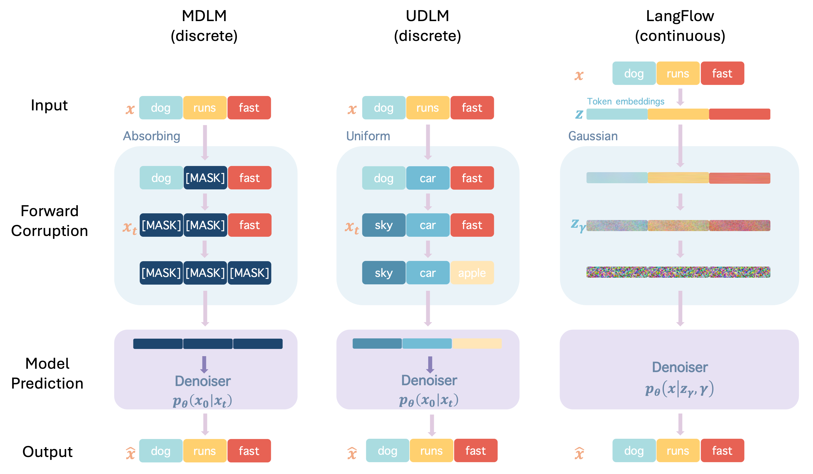
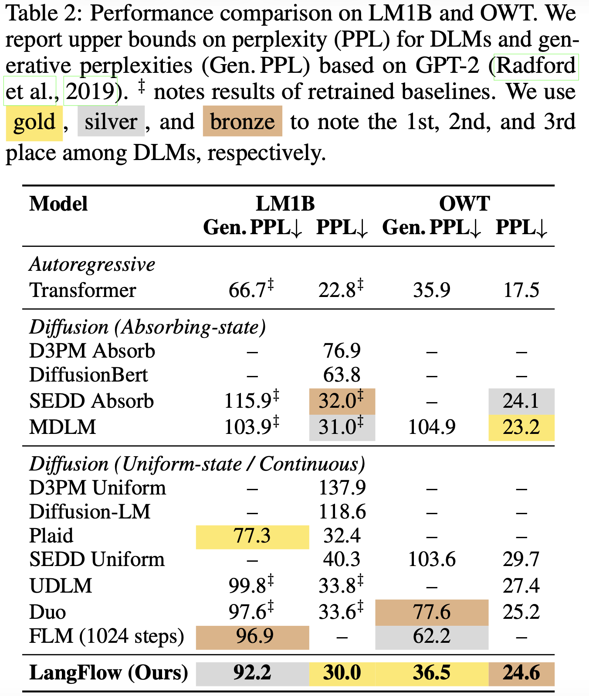

<div align="center">

# LangFlow: Continuous Diffusion Rivals Discrete in Language Modeling

</div>

[](https://arxiv.org/abs/2604.11748) [](https://huggingface.co/Continuous-Rivals-Discrete/langflow-owt) [](https://huggingface.co/Continuous-Rivals-Discrete/langflow-lm1b) [](https://caradryanl.github.io/blog/2026/langflow/)

By Yuxin Chen*, Chumeng Liang*, Hangke Sui*, Ruihan Guo, Chaoran Cheng, Jiaxuan You, Ge Liu.

<div align="center">
  
  
</div>

This repository contains the code to train and evaluate LangFlow and the baselines of the paper (AR, MDLM, SEDD, UDLM, Duo), and to sample from the released LangFlow checkpoints.

## TODO

- [x] Inference code
- [x] PPL evaluation code
- [x] OpenWebText checkpoint on [HuggingFace](https://huggingface.co/Continuous-Rivals-Discrete/langflow-owt)
- [x] LM1B checkpoint on [HuggingFace](https://huggingface.co/Continuous-Rivals-Discrete/langflow-lm1b)
- [x] Training code for LangFlow and the baselines
- [x] Trainable checkpoints of LangFlow and the baselines (see [Checkpoints](https://drive.google.com/drive/folders/115g7YaipFilwT6iF2rNLLUl6hy6p-U5z?usp=sharing))

## Installation

```bash
conda create -n langflow python=3.12
conda activate langflow
# Install CUDA-enabled torch first (adjust cu124 to match your driver)
pip install torch --index-url https://download.pytorch.org/whl/cu124
pip install -r requirements.txt
```

The code is pure PyTorch (no flash-attn needed). Datasets are downloaded, tokenized and cached on first use in `$DATA_CACHE`, which the data configs (`configs/data/*.yaml`) read:

```bash
export DATA_CACHE=/path/to/data/cache
```

## Quick Start: Sampling with the HuggingFace Checkpoints

Download only the safetensors weights file from HuggingFace — no need to clone the HF repo:

```bash
hf download Continuous-Rivals-Discrete/langflow-owt model.safetensors --local-dir ./checkpoints

python inference.py \
    --checkpoint ./checkpoints/model.safetensors \
    --num_samples 5 \
    --batch_size 1 \
    --num_steps 1024 \
    --seq_length 1024 \
    --seed 42 \
    --output samples.txt
```

`--checkpoint` also accepts a directory or a Hub repo id, and the tokenizer is inferred from the checkpoint. For LM1B, use `--checkpoint Continuous-Rivals-Discrete/langflow-lm1b --num_steps 128 --seq_length 128`.

**Samplers.** The default `--sampler ode` is the deterministic Euler solver of the probability-flow ODE over the learned Gumbel schedule (`num_steps` NFEs). `--sampler sde` makes every step stochastic: it re-noises the state from log-NSR $\gamma$ to $\gamma +$ `--sde_offset`, denoises there, and takes the Euler step from the original (`--sde_mode elf`) or re-noised (`--sde_mode edm`) state; `--sde_offset 0` recovers the ODE. Both samplers accept `--temperature T`, which replaces every denoised embedding by $E^\top \mathrm{softmax}(\text{logits}/T)$ (lower is sharper; used for the Gen. PPL / entropy frontier).

The model can also be used from Python:

```python
from langflow import LangFlow

model = LangFlow.from_pretrained("Continuous-Rivals-Discrete/langflow-owt").cuda().eval()
token_ids = model.generate_samples(num_samples=4, num_steps=1024, sampler="sde", temperature=0.9)
```


## Training

`scripts/train.sh <dataset> <algorithm>` trains any model with the settings of the paper, where `<dataset>` is `lm1b` or `owt` and `<algorithm>` is one of `langflow`, `ar`, `mdlm`, `sedd`, `udlm`, `duo`:

```bash
bash scripts/train.sh owt langflow
bash scripts/train.sh lm1b mdlm
```

`BATCH_SIZE` sets the per-GPU batch size (gradients are accumulated to the global batch size of 512), and any Hydra override can be appended, e.g. `trainer.num_nodes=2`. Training logs to Weights & Biases (append `wandb.mode=disabled` to turn this off). Runs are written to `outputs/<dataset>/<date>/<time>/` and resume from `checkpoints/last.ckpt` when restarted in the same directory (set `hydra.run.dir`). The scripts are thin wrappers around `main.py`, e.g. LangFlow on OpenWebText is

```bash
python main.py -cn langflow-owt loader.batch_size=16 loader.eval_batch_size=16
```

LangFlow's hyperparameters live in `configs/algo/langflow.yaml` (self-conditioning probability 0.25, 5K-step warmup of the preconditioning skip connection, learnable Gumbel noise schedule). During training, validation reports the variational (SDE) bound on the NLL.

## Evaluation

All evaluations take a `.ckpt` checkpoint. For LangFlow, the released HuggingFace weights work as well: pass a `model.safetensors` file, a directory or a Hub repo id.

### Samples and Gen. PPL

`scripts/gen_ppl.sh` generates 1024 samples (128 steps on LM1B, 1024 on OpenWebText) and reports their Gen. PPL under GPT-2 Large and their average unigram entropy; samples are saved to `samples_<algorithm>_<dataset>.json`.

```bash
bash scripts/gen_ppl.sh owt langflow /path/to/langflow_owt.ckpt
bash scripts/gen_ppl.sh owt langflow Continuous-Rivals-Discrete/langflow-owt
bash scripts/gen_ppl.sh lm1b mdlm /path/to/mdlm_lm1b.ckpt

# LangFlow with the SDE sampler and temperature 0.9
bash scripts/gen_ppl.sh owt langflow /path/to/langflow_owt.ckpt \
    sampling.predictor=sde sampling.temperature=0.9 sampling.sde_offset=0.1 sampling.sde_mode=elf
```

The sampler options (`sampling.predictor=ode|sde`, `sampling.temperature`, `sampling.sde_offset`, `sampling.sde_mode`) are the same as in `inference.py`; append `sampling.steps=<N>` for other numbers of steps.

### Perplexity

`scripts/eval_ppl.sh` evaluates the validation perplexity (an upper bound for the diffusion models) on all visible GPUs:

```bash
bash scripts/eval_ppl.sh owt langflow /path/to/langflow_owt.ckpt
bash scripts/eval_ppl.sh lm1b duo /path/to/duo_lm1b.ckpt
```

For LangFlow, `eval.ppl_bound` selects the bound:

- `eval.ppl_bound=ode` (default): the bound from the probability-flow ODE, i.e. the reconstruction loss at $\gamma_{\min}$, the divergence integral from $\gamma_{\min}$ to $\gamma_{\max}$ (Hutchinson estimator, `eval.ode_steps=128` steps of `eval.ode_method=heun2`) and the Gaussian prior at $\gamma_{\max}$. Self-conditioning enters the divergence in one of two protocols:
  - `eval.self_cond=attached` (default): gradients flow through the self-conditioning input, i.e. the divergence of the full self-conditioned vector field (chain rule);
  - `eval.self_cond=detached`: the self-conditioning input is treated as a constant in the divergence.

  `eval.self_cond=off` disables self-conditioning altogether.
- `eval.ppl_bound=sde`: the variational bound (as in Plaid), which is also reported during training.

```bash
bash scripts/eval_ppl.sh owt langflow /path/to/langflow_owt.ckpt eval.self_cond=detached
bash scripts/eval_ppl.sh owt langflow /path/to/langflow_owt.ckpt eval.ppl_bound=sde
```

The ODE bound back-propagates through the model at every solver step and is expensive on OpenWebText; use several GPUs (`trainer.num_nodes=<N>` for multiple nodes) or `trainer.limit_val_batches` for a quick estimate.

Zero-shot perplexities of OpenWebText models on the other datasets of the paper:

```bash
bash scripts/zero_shot.sh langflow /path/to/langflow_owt.ckpt
```

## Acknowledgements

The training framework, the data pipeline and the baselines are adapted from [Duo](https://github.com/s-sahoo/duo) and [MDLM](https://github.com/kuleshov-group/mdlm) (Apache 2.0, see `duo/LICENSE`).

## Citation

```
@article{chen2026langflow,
  title={LangFlow: Continuous Diffusion Rivals Discrete in Language Modeling},
  author={Chen, Yuxin and Liang, Chumeng and Sui, Hangke and Guo, Ruihan and Cheng, Chaoran and You, Jiaxuan and Liu, Ge},
  journal={arXiv preprint arXiv:2604.11748},
  year={2026}
}
```
